<p align="center">
  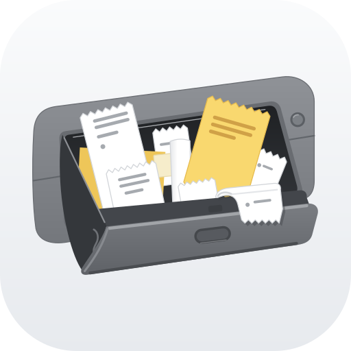
</p>

<h1 align="center">Glovebox</h1>

<p align="center">A redesigned <a href="https://github.com/hargata/lubelog">LubeLogger</a> that puts what's due next front and center.<br>Self-hosted vehicle maintenance, reminders with ntfy push notifications, notes and records.</p>

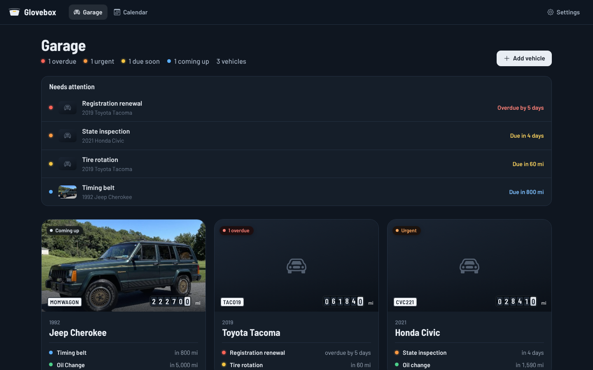

<table>
  <tr>
    <td width="25%">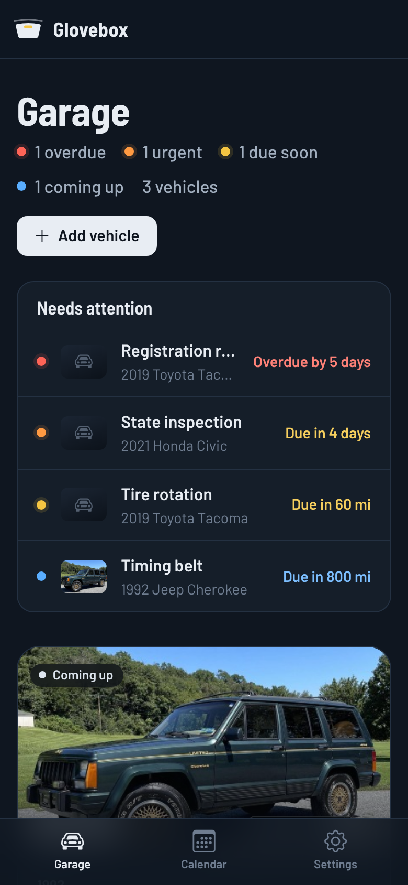</td>
    <td width="25%">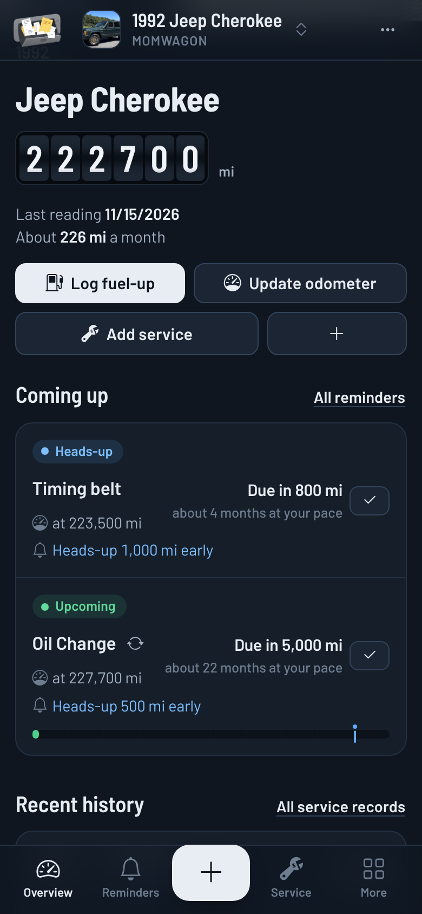</td>
    <td width="25%">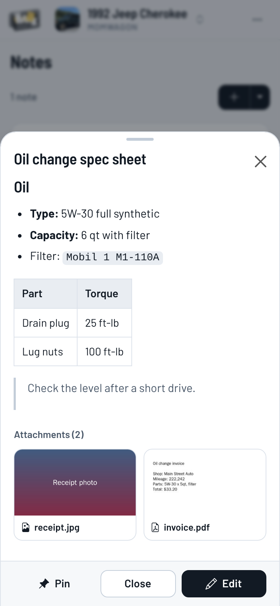</td>
    <td width="25%">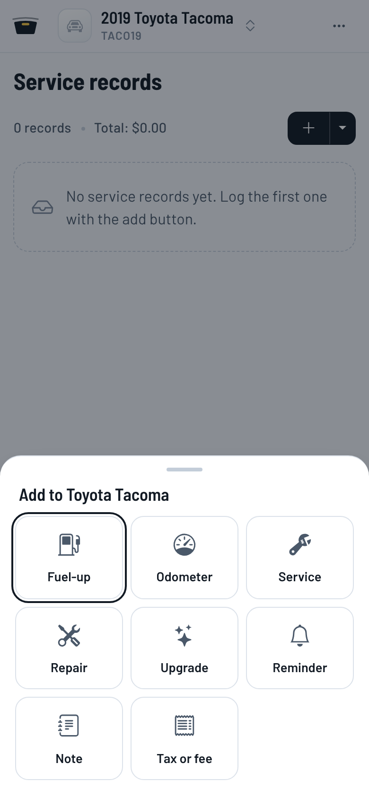</td>
  </tr>
</table>

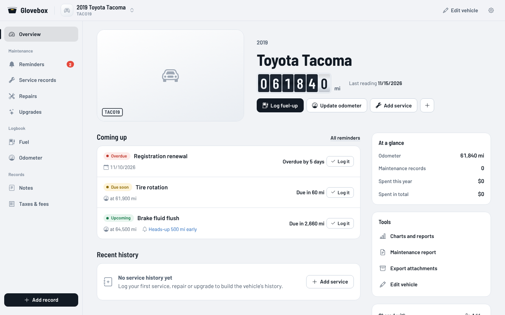

<table>
  <tr>
    <td width="50%">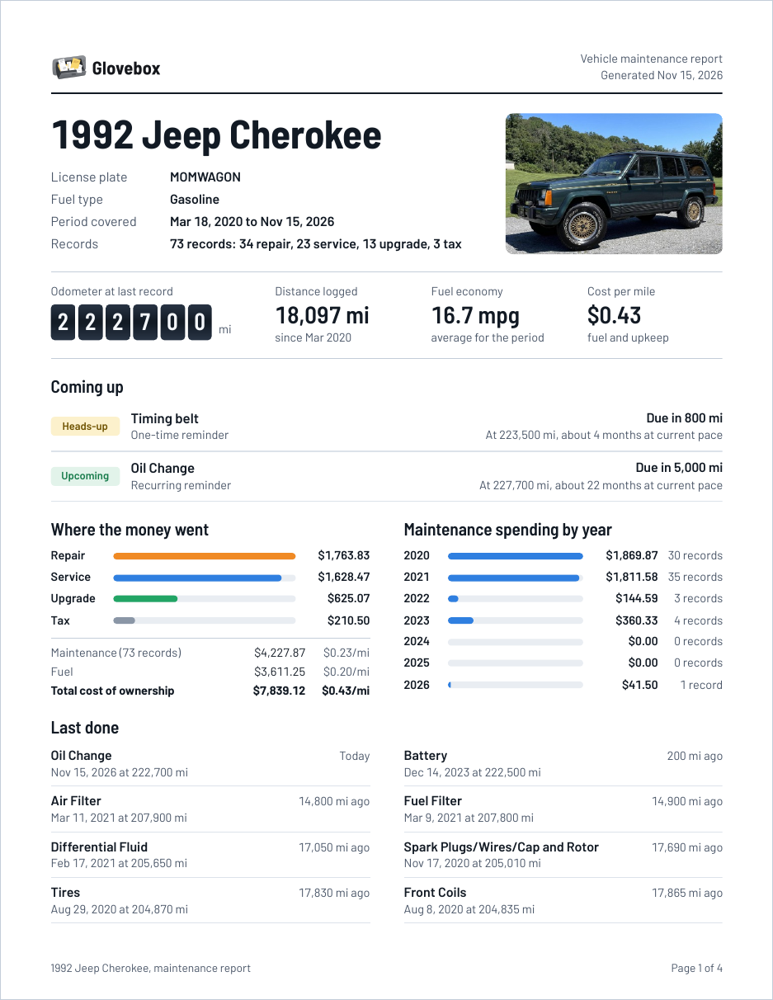</td>
    <td width="50%">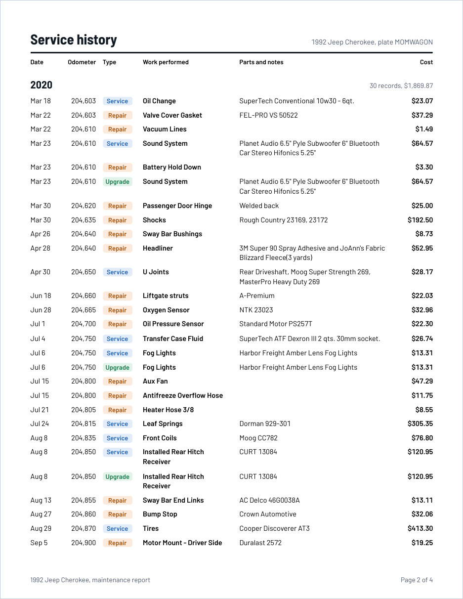</td>
  </tr>
</table>

## What's different from LubeLogger

Glovebox runs on the same code base and reads and writes exactly the same data, so an existing LubeLogger install can switch to it (and back) without migrating anything.

- **A garage that tells you what needs attention.** Each vehicle card shows its odometer, its status and the next two things due. Overdue, urgent and due-soon items across every vehicle are pulled to the top.
- **A vehicle overview built around upcoming work.** The old dashboard of charts is replaced with what's coming up (with progress through each interval and an estimate of when it'll be due at your driving pace), recent history and the numbers that matter. Charts are still one tap away.
- **Phone-first.** Bottom navigation, one-tap quick add for every record type, bottom-sheet forms and lists that turn into cards on small screens.
- **Notes that read like notes.** Clicking a note shows the rendered markdown and its attachments. Editing is a button away instead of the default.
- **Attachments open in the app.** Images, PDFs (rendered in the page, with zoom), video, audio, text, CSV and markdown open in a full-screen viewer with swipe and arrow-key navigation. Downloading is still there.
- **Push notifications with ntfy.** Get a notification when a reminder is coming up, due soon, urgent or overdue, with quiet hours and optional repeats for overdue items.
- **Heads-up before it's due.** Set a default early warning (for example 500 miles or 14 days) and override it per reminder, so you have time to order parts before the due date arrives.
- **A maintenance report worth handing over.** A summary page with what's coming up, where the money went and when routine items were last done, followed by the full service history grouped by year. It prints cleanly on Letter paper, in light or dark mode.
- **Hide cost tracking.** One switch in Settings hides every cost field, column, total and chart. Amounts you've already entered are kept.
- **Settings that make sense.** Grouped into Appearance, Vehicles, Notifications, Units, Costs, Records, Automation, Server and About, and every change saves on its own.
- **No search.** The global search, garage search and per-table search are gone. Tag filters remain.
- **Engine health straight from the car** (on the `CANary` branch). A [CANary](https://github.com/au12/CANary) device in the diagnostic port keeps the odometer current and uploads every drive; Glovebox turns them into a weekly report. See [CANary diagnostics](#canary-diagnostics).

Smaller fixes along the way:

- Custom urgency thresholds on one reminder no longer leak into the reminders listed after it.
- Attachment names containing apostrophes or ampersands no longer break previews, renames or links.
- Markdown in notes is sanitized before it's rendered.
- Sorting by columns that contain numbers over 999,999 works.
- Odometer readings are shown with thousands separators.
- The reminder status chart uses the right colors (overdue is red, not grey).

## Install

The image is published to GitHub Container Registry for `linux/amd64` and `linux/arm64`:

```
ghcr.io/au12/glovebox:latest
```

`latest` follows the `main` branch. To stay on a release, use its version instead, for example `ghcr.io/au12/glovebox:0.2.0`. Releases are listed on the [releases page](https://github.com/au12/glovebox/releases).

### Switching an existing LubeLogger container on Unraid

1. On the Docker tab, click the LubeLogger icon and choose **Edit**.
2. Change **Repository** from `ghcr.io/hargata/lubelogger:latest` to `ghcr.io/au12/glovebox:latest`.
3. Leave every path, port and variable exactly as it is, then click **Apply**.

Your database, photos, documents, translations and settings live in the mapped `/App/data` folder, and sign-in keys live in `/root/.aspnet/DataProtection-Keys`, so they carry over untouched. To go back, set the repository to `ghcr.io/hargata/lubelogger:latest` again. Notification settings and per-reminder heads-up values are extra fields that LubeLogger simply ignores.

If you want a safety net, make a backup from LubeLogger's Settings page before you switch (in Glovebox it's **Settings > Server > Download backup**).

### New install on Unraid

Once Glovebox is listed in Community Apps, search for it on the **Apps** tab and click **Install**. Until then, save [`templates/glovebox.xml`](templates/glovebox.xml) to `/boot/config/plugins/dockerMan/templates-user/my-Glovebox.xml` on your flash drive, then pick **Glovebox** from the template list under **Docker > Add Container**:

```
wget -O /boot/config/plugins/dockerMan/templates-user/my-Glovebox.xml https://raw.githubusercontent.com/au12/glovebox/main/templates/glovebox.xml
```

New installs keep their data in `/mnt/user/appdata/glovebox`. Set **Disable account registration** to `true` (under Show more settings) if the server is reachable from the internet and you don't want a Create account page at all.

### Docker Compose

```yaml
services:
  app:
    image: ghcr.io/au12/glovebox:latest
    restart: unless-stopped
    environment:
      - LANG=en_US.UTF-8
      - LC_ALL=en_US.UTF-8
      - TZ=America/Chicago
    volumes:
      - data:/App/data
      - keys:/root/.aspnet/DataProtection-Keys
    ports:
      - 8080:8080

volumes:
  data:
  keys:
```

`docker-compose.postgresql.yml` and `docker-compose.traefik.yml` work the same way as upstream.

## Reminder notifications

1. Install the [ntfy app](https://ntfy.sh) and subscribe to a topic that's hard to guess, or use your own ntfy server.
2. In Glovebox, open **Settings > Notifications**, turn on **Send reminder notifications**, and enter the server and topic. Add an access token or a username and password if your topic is protected.
3. Set **Open this address when tapped** to the URL you use for Glovebox so a notification opens the right vehicle.
4. Click **Send a test**.

Glovebox checks reminders every 15 minutes and right after you add or change a record. Each stage (heads-up, due soon, urgent, overdue) is sent once per due cycle, so you won't get the same alert twice. When a recurring reminder rolls forward, the cycle starts over.

The default heads-up applies to every reminder. To change it for one reminder, open the reminder and pick **Custom** under **Heads-up before it's due**, or **None** to skip the early warning. **Mute all notifications for this reminder** silences it completely.

Every account sets up its own notifications. Tokens and passwords are stored on the server and never sent back to the browser.

## CANary diagnostics

> This section lives on the [`CANary` branch](https://github.com/au12/glovebox/tree/CANary) and is published as `ghcr.io/au12/glovebox:canary` until it is merged into `main`. It reads and writes the same data as `latest`, so switching the tag back and forth is safe.

[CANary](https://github.com/au12/CANary) is open firmware for the MeatPi WiCAN Pro, a small device that stays plugged into the car's OBD-II port. It watches the engine on every drive and, each time the car is back on your Wi-Fi, checks in with Glovebox. Every vehicle gets a **CANary** section under **Diagnostics**:

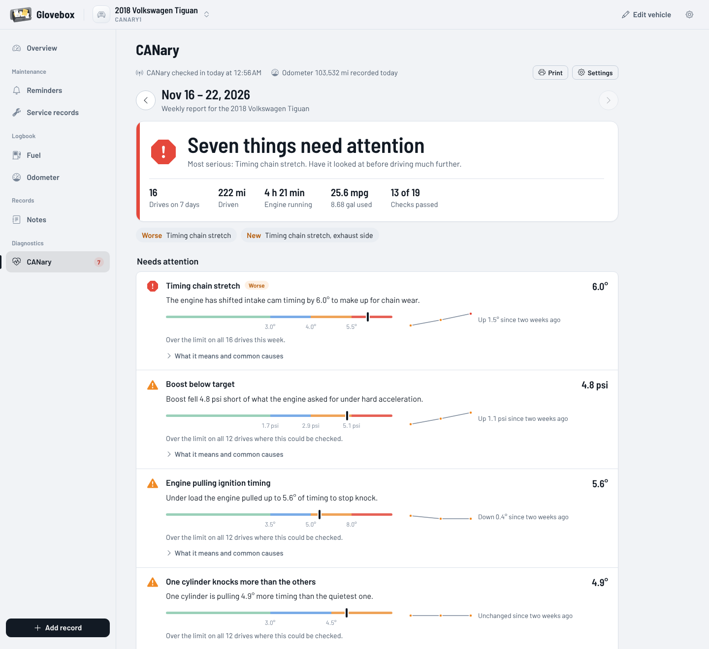

<table>
  <tr>
    <td width="25%">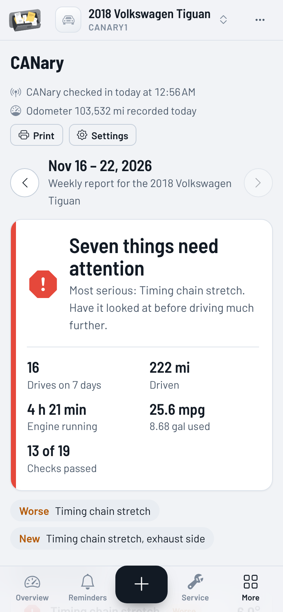</td>
    <td width="25%">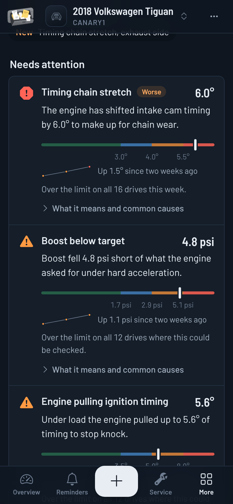</td>
    <td width="25%">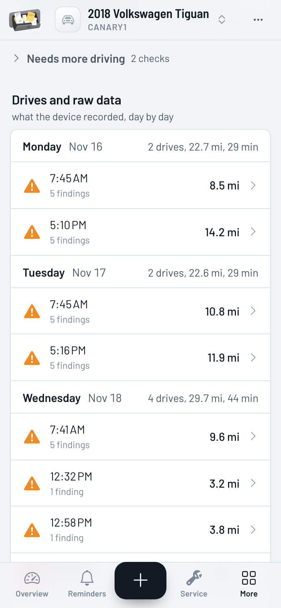</td>
    <td width="25%">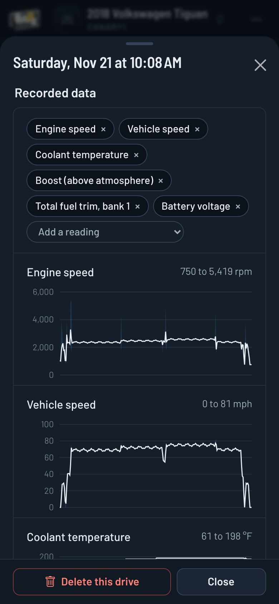</td>
  </tr>
</table>

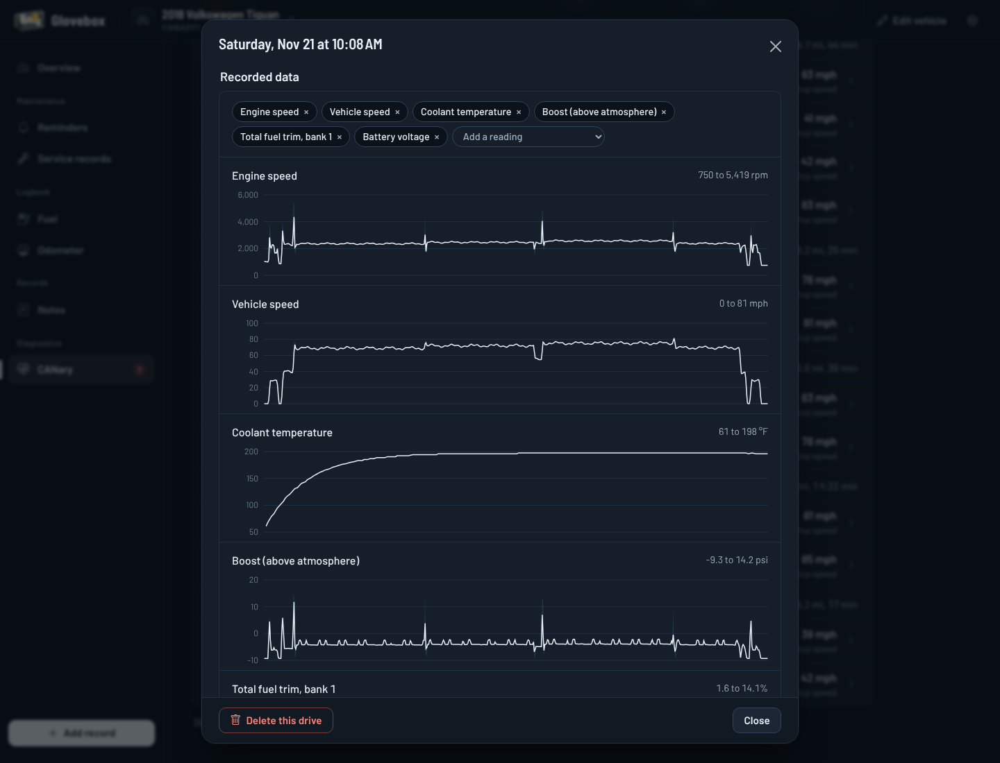

- **The odometer keeps itself up to date.** Every check-in records the reading: one record a day, tagged `canary`, moved forward as the day's readings come in and never backward.
- **A weekly report in plain language.** One verdict at the top ("All clear", "Two things need attention"), then every finding ordered by severity. Each one shows where the reading sits against its limits, how it has moved over the past weeks, how many drives it showed up on, what it means and the usual causes.
- **What changed since last week.** New findings, ones that got worse, ones that cleared.
- **Trouble codes with their meaning,** from every control unit the vehicle profile covers, marked stored, pending or permanent.
- **Every drive, day by day,** with the raw recording behind it: pick any of the logged readings to chart, or download the log itself.
- **Prints as a report** you can hand to a mechanic, explanations included.
- **Notifications through ntfy** when a warning, a critical finding or a stored code first appears, plus a short summary when a week has ended. A backlog uploaded days late does not page you.

<table>
  <tr>
    <td width="50%">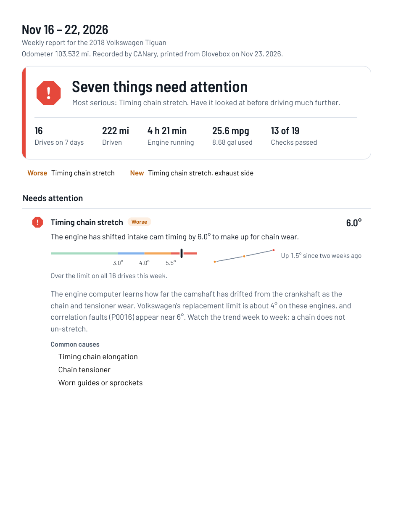</td>
    <td width="50%">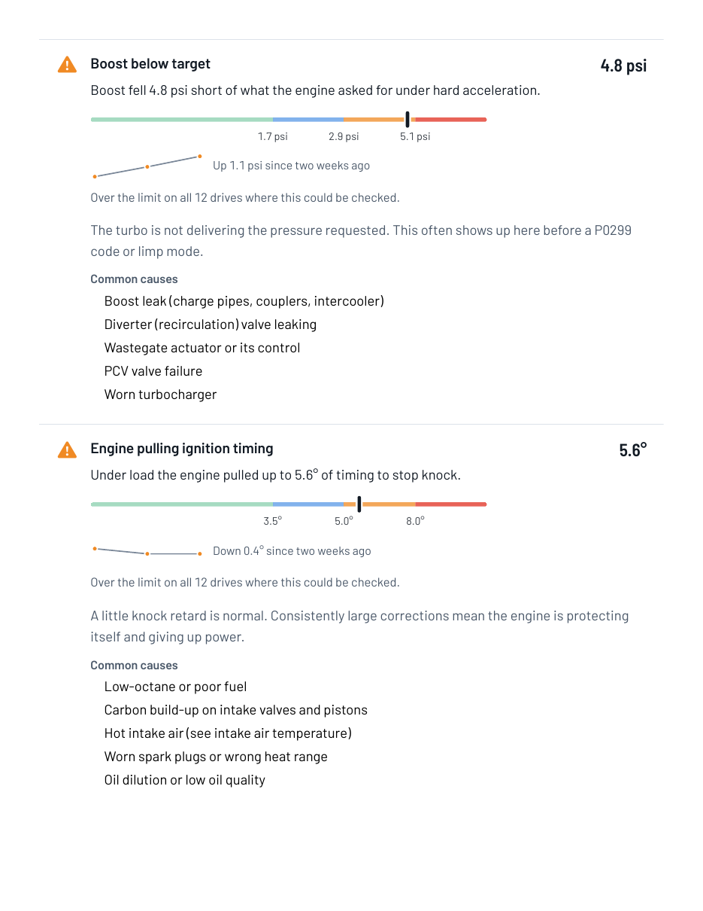</td>
  </tr>
</table>

### Connecting a device

1. Run the `canary` image: change the container's repository to `ghcr.io/au12/glovebox:canary`. Nothing else changes.
2. Open the vehicle, choose **CANary** and note the three values shown: the address of your Glovebox, the vehicle number and, if your Glovebox has a login, an API key (the page creates one for you).
3. Enter them on the device's own page under **Device > Glovebox**. The first check-in appears within a minute.

The device needs to reach Glovebox over your home Wi-Fi; nothing is sent anywhere else.

### How the report is made

The device uploads its raw recording of each drive. Glovebox runs the vehicle profile's health checks over that recording itself, so the report does not depend on what the device concluded at the time: when a profile improves, **Settings > Analyse every drive again** re-reads the history with the new rules. A week's verdict pools the week's drives, so a check that needs two minutes of hard acceleration can be judged from many short bursts. The analysis is a port of the firmware's own and is tested against it on every build (`dotnet run --project tools/CanarySelfTest`).

Everything is kept in `data/canary` inside the data folder, next to the database: one compressed log and one small summary per drive. Raw logs can be removed automatically after a number of months (the summaries, and with them the reports, stay). The built-in **Download backup** does not include this folder yet; a backup of the data folder itself does. Details, including the device API, are in [docs/canary.md](docs/canary.md).

## Building it yourself

```
dotnet publish -c Release -o out
cd out && ./CarCareTracker
```

or `docker build -t glovebox .`. Every push to `main` builds and publishes `latest` and a `sha-` tag through GitHub Actions. Tags named `v1.2.3` also publish `1.2.3` and `1.2`. Pushes to the `CANary` branch publish `canary` and a `canary-<sha>` tag.

If the package page on GitHub shows the image as private after the first build, open **Package settings** and change its visibility to public so Unraid can pull it without signing in.

## Releases

Releases are published automatically. When `GloveboxVersion` in `Helper/StaticHelper.cs` changes on `main` and that version has no release yet, the Release workflow creates the `v<version>` tag and release, using the matching section of `CHANGELOG.md` as the notes, then builds and pushes the `<version>` and `<major>.<minor>` images. Add the changelog section before bumping the version; the workflow fails without it.

## Credits

Glovebox is a fork of [LubeLogger](https://github.com/hargata/lubelog) by Hargata Softworks. LubeLogger's [documentation](https://docs.lubelogger.com) covers everything that works the same way, which is most of it: record types, the planner, inspections, supplies, the API, OpenID, PostgreSQL and backups.

Built with [Bootstrap](https://github.com/twbs/bootstrap), [Bootstrap Icons](https://github.com/twbs/icons), [LiteDB](https://github.com/mbdavid/litedb), [Npgsql](https://github.com/npgsql/npgsql), [Bootstrap-DatePicker](https://github.com/uxsolutions/bootstrap-datepicker), [SweetAlert2](https://github.com/sweetalert2/sweetalert2), [CsvHelper](https://github.com/JoshClose/CsvHelper), [Chart.js](https://github.com/chartjs/Chart.js), [marked](https://github.com/markedjs/marked), [DOMPurify](https://github.com/cure53/DOMPurify), [PDF.js](https://github.com/mozilla/pdf.js), [MailKit](https://github.com/jstedfast/MailKit), [Masonry](https://github.com/desandro/masonry), [QRCode-Generator](https://github.com/kazuhikoarase/qrcode-generator) and the [Barlow](https://github.com/jpt/barlow) typeface.

## License

MIT, the same as LubeLogger. See [LICENSE](LICENSE).
